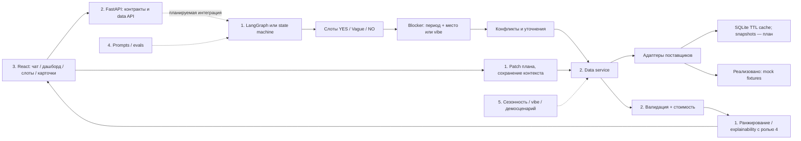

# Архитектура по доске

Предыдущий этап 0.3.0: [полная поставка Backend/Data](data-delivery.md). Более ранние ограничения ниже относятся к соответствующим этапам; текущие endpoints и блокеры перечислены в итоговом отчёте.
Текущее состояние 0.4.0: [единая база и загрузчик](database.md).

## Приоритет источников

1. Доска и распределение ролей из сообщения пользователя.
2. Приложенный `codex_plan_…md` — вспомогательный план, его решения не являются отдельными указаниями пользователя.
3. Ссылка на кейс Островка — требует повторного доступа: при подготовке получен 403 CONNECT. Содержание по ссылке не проверено.

Поэтому сохраняем до **5** вариантов, источники API, слоты `YES` / `Vague` / `NO`, проверку конфликтов, пересборку и сценарии раннего заезда/трансфера после покупки. Не переносим из старого плана запрет на сопровождение после покупки, ограничение на три варианта, обязательную локальную Qwen или обязательную ручную загрузку всех данных. Дедлайн 5 дней из вложения используется ниже как ориентир, а не подтверждённое обязательство.

## Компоненты и владельцы

Начинаем с модульного монолита, не с пяти микросервисов. В текущем коде реализована только зона data API с mock-каталогом. AI/UI на схеме — согласуемые границы, не существующие сервисы.

## Сквозной поток

1. Роль 1 извлекает слоты. Роль 4 задаёт JSON Schema/промпты и проверяет интерпретацию. `NO` означает отсутствие значения, а не отрицательное значение: `pets=false` может быть подтверждённым `YES`.
2. Blocker на доске проверяет период (даты либо сезон для исследования) и place/vibe. При недостатке данных спрашивает агент. Роль 2 не генерирует уточняющие реплики.
3. Для исследования направления можно работать с месяцем и vibe. Для **точной котировки** нужны город отправления, конкретные даты, взрослые, возраст каждого ребёнка, животные. Эти два этапа нельзя смешивать.
4. Data service вызывает независимые адаптеры параллельно с ограничением concurrency и deadline. Нормализует результаты и проверяет обязательные условия. Сейчас вместо сетевых вызовов используется fixture.
5. Сборщик считает полную стоимость отеля, дороги туда и обратно, обоих трансферов и обязательных сборов. Неизвестное обязательное условие не считается выполненным. Ранний прилёт при допустимом ожидании — предупреждение; ранний заезд не обещается.
6. Роль 1 ранжирует допустимые варианты, совместно с ролью 4 объясняет компромиссы. Каркас пока сортирует допустимые бандлы только по цене и возвращает максимум пять.
7. Перед подтверждением выбора нужны повторная проверка наличия/цены и версии плана. На доске это «указываются актуальные данные». В mock-каркасе настоящего подтверждения нет.
8. После изменения дат/гостей агент сохраняет остальные слоты, увеличивает версию и заново запрашивает зависимые компоненты. UI игнорирует ответы старой версии. Data API сейчас только возвращает переданную версию, не обеспечивает конкурентную блокировку.
9. После покупки ранний заезд/трансфер оформляются отдельным запросом услуги и требуют подтверждения поставщика. Изменение предложения не меняет уже купленные компоненты молча.

## Зависимости кода

| Зависимость | Назначение | Сейчас |
|---|---|---|
| Python 3.12 | единый runtime | используется |
| FastAPI + Uvicorn | HTTP и OpenAPI | используется |
| Pydantic 2 | валидация контрактов и JSON Schema | используется |
| pydantic-settings | настройки без ключей в коде | используется |
| httpx | будущие async API-клиенты; TestClient | установлен |
| pytest / Ruff | содержательные проверки и lint | используется |
| uv / uv.lock | воспроизводимые зависимости | lock сохранён |
| sqlite3 (stdlib) | локальный TTL-кэш, не требует сервера | используется |
| LangGraph + выбранный LLM SDK | граф/модель, ответственность роли 1 | не установлен: выбрать с владельцем |
| React / TS / Vite / TanStack Query | UI роли 3 | план, frontend пока не создан |
| Vitest / Playwright | UI и сквозные evals | после появления frontend |

Не добавляем Redis, Celery, отдельный DB-сервер, ORM, Docker и векторную БД до появления конкретной потребности. Отсутствие отдельного сервиса кэша позволяет демонстрировать данные локально. Сторонние MCP-клиенты добавляются после подтверждения схемы и прав доступа, а не по предположению, что любой поставщик уже имеет MCP.

## Модель хранения: целевая, ещё не реализована

Из таблиц доски выделяем сущности: `destinations` (city, country, координаты, timezone, vibe tags), `hotel_properties` (звёзды, рейтинг, review_count, расстояния), `hotel_quotes`, `transport_quotes`, `transfer_quotes`, `weather_samples`, `entry_rules`, `budget_statistics` и `quote_provenance`.

Гости и даты — параметры запроса/котировки, а не глобальные справочники. Возраст ребёнка хранится явно; `total_guests` вычисляется. В цене обязательны `currency`, `price_basis` (stay/room/person/vehicle), `amount`, условия, идентификатор источника, `fetched_at`, `valid_until`, параметры применимости. Время — ISO 8601 с offset и IANA timezone в нормализованной live-модели; сравнение по UTC. Ночи считаются по локальным датам отеля, а не разнице UTC-часов.

Таблица бюджета с доски — статистика для исследования направлений, не подтверждённая котировка. Средний чек не подставляется в корзину. Ближайший аэропорт, число пересадок, багаж, тариф, unit цены, `all_inclusive`, сезон и снежный покров должны появиться в моделях соответствующего адаптера, если нужны сценарию. В стартовом коде этих полей нет — это отмечено в backlog.

Целевые таблицы кэша: `provider_cache(key, schema_version, payload, fetched_at, expires_at)` и `provider_runs(provider, latency_ms, status, fallback_kind)`. Сессии, сообщения, изменения слотов и выбранный план принадлежат AI-слою; согласовать SQLite-хранилище с ролью 1. Для демозаказа позже нужны отдельные order/line-item таблицы и idempotency key.

Реализованные изменения версии 0.2.0 и оставшиеся границы: [этап Backend/Data 1](data-milestone-1.md). Таблицы полного каталога и snapshots в разделе выше остаются целевой моделью; текущий кэш хранит provider payload/TTL.
