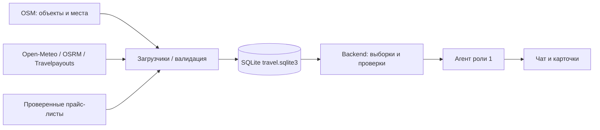

# БД для агента: устройство и автоматическое наполнение

## Основное решение

Агент получает факты из общей БД через backend. Загрузчики независимо получают данные из API, открытых выгрузок и проверенных файлов, нормализуют их и записывают в БД. Во время чтения каталога агент не вызывает поставщиков и не парсит сайты.



Для общего демо достаточно **одного backend с одной SQLite-БД**: коллеги обращаются к нему по HTTP, а не копируют изменяемый файл друг другу. Локально каждый может воспроизводимо собрать свою БД. WAL, индексы и транзакции уже настроены. При нескольких backend-серверах следующим этапом будет PostgreSQL с миграциями; он сейчас не реализован и для первого демо не требуется.

## Что храним по доске

[Полная схема, связи и SQL](database.md).

| Сущность | Таблицы | Наполнение и ограничения |
|---|---|---|
| Города, координаты, timezone, vibe | `destinations` | Версионируемый JSON команды; vibe/сезонность — редакционные гипотезы |
| Размещение: название, адрес, координаты, звёзды, сайт | `hotels` | OSM XML → нормализованные записи. Уже есть 62 объекта в четырёх выбранных районах; это не полное покрытие городов |
| Парки, пляжи, музеи, рестораны | `activities` | Тот же OSM-снимок, 173 объекта. Указаны источник и лицензия ODbL |
| Погода по дням | `weather` | Open-Meteo → прогноз с датой получения и сроком годности. Не прогноз на произвольный месяц |
| Время и расстояние по координатам | `routes` | OSRM → маршрут конкретной пары точек; стоимость неизвестна |
| Оценки авиабилетов | `transport_estimates` | Travelpayouts Data API → кэшированные оценки; `bookable=0`, не цена поездки для всех гостей |
| Цены проживания | `hotel_quotes` | Точные даты, гости, валюта, условия, источник, срок. Сейчас шесть демотарифов; реальные можно загрузить проверенным импортом |
| Дорога, трансферы | `transport_quotes`, `transfer_quotes` | Сейчас демотарифы. Нужны отдельные источники, чтобы заполнить реальными значениями |
| Гости, даты | `guests`, `calendar_dates` | Автоматически из применимости котировок; не персональные профили клиентов |
| Визы | `visa_rules` | Сейчас явно `unknown`. Реальные правила требуют проверенного источника с датой проверки |
| Статистика бюджета | `budget_statistics` | Вычисляется из котировок с разделением режимов; сейчас в основном mock. Не используется как подтверждённая цена корзины |
| Источники, история загрузки | `ingest_sources`, `ingest_runs`, `ingestion_jobs` | Хеши, время успеха, количество, ошибки; без секретов |

Отсутствующие рейтинг, правила животных, питание или тариф сохраняются как `NULL`/неизвестное. Отсутствие данных не означает запрет или нулевую цену.

## Как наполняем автоматически

**1. Начальная загрузка без сети.** Из Git берутся небольшие OSM-снимки, база знаний и отдельно демоданные. После импорта все запросы каталога читают БД:

```bash
uv sync --frozen
uv run python scripts/load_database.py
```

**2. Обновление доступных API.** Отдельный worker получает прогнозы, маршруты и авиаоценки и записывает их в ту же БД:

```bash
uv run python scripts/ingestion_worker.py --once
# Или непрерывно, в отдельном терминале/под менеджером процессов:
uv run python scripts/ingestion_worker.py --interval 1800
```

Каждые 30 минут запускается проверка обновления; TTL-кэш может сократить сетевые обращения. Worker работает, пока жив его процесс; это не установленный системный сервис. Ключ Travelpayouts хранится в `TRIP_TRAVELPAYOUTS_TOKEN` через секреты среды. Без него соответствующая загрузка отмечается как не настроенная, данные не выдумываются.

Текущее покрытие загрузчика ограничено: четыре города, прогноз на три дня, авиа MOW → выбранный город с вылетом через 21 день и возвратом через 26 дней, один маршрут центр → объект на город. Это начальный набор для исследования, а не все возможные поездки. Расширение списка пар координат/дат и городов — следующая задача по реальным сценариям команды.

**3. Обновление статических объектов.** Редко и отдельно, например раз в неделю, обновляем ограниченные OSM-районы:

```bash
uv run python scripts/load_database.py --refresh-hotels
```

Это существующий ограниченный XML-парсер публичного OSM API. Не нужно писать универсальный парсер всех сайтов отелей. Для больших регионов следующим этапом нужны региональные выгрузки OSM/PBF и пакетный импорт; такой загрузчик пока не реализован. Учитываем лицензии и ограничения источника, не пытаемся скачивать весь мир через публичный map API.

**4. Тарифы отелей.** Пока доступа к hotel API нет, можно импортировать структурированный прайс-лист, полученный от объекта/партнёра, через готовый `scripts/import_hotel_rates.py`. В записи нужны реальный ID объекта, даты, гости, цена, условия и HTTPS-ссылка на подтверждение. Импортёр проверяет схему и связи, но проверку истинности цены выполняет человек. [Формат и команда](role-2-final-status.md).

Клиент LiteAPI подготовлен, но его ответы сейчас не сохраняются автоматически как `HotelQuote`. Для такого загрузчика ещё нужны ключ, сопоставление provider ID ↔ объект БД и проверка полного состава цены/условий. Не смешиваем sandbox-тарифы с реальными.

## Почему нельзя заранее загрузить «все цены»

Тариф зависит от дат, длительности, взрослых, возраста детей, номера и питания. Перебор всех сочетаний быстро превысит лимиты поставщиков. Поэтому заранее загружаем справочники и небольшой набор востребованных котировок.

Для расширения после первого сквозного демо предлагается **очередь запросов на обновление**: агент обнаруживает пробел → backend сохраняет нормализованный запрос → worker получает данные → записывает котировки → агент повторяет чтение БД. Одинаковые запросы объединяются по хешу, повторы ограничиваются таймаутом и backoff. Это следующий этап, очередь пока не реализована. Агент при этом по-прежнему читает факты только из БД.

## Готовый интерфейс чтения для роли 1

Новый endpoint **не делает внешних запросов**:

```http
POST /api/v1/catalog/context
Content-Type: application/json

{"city":"Сочи","start_date":"2026-11-10","end_date":"2026-11-15","origin":"MOW","limit":10}
```

Можно передать только город; даты задаются парой. Ответ содержит `read_from=database`, `checked_at`, карточку направления, `sections` и `sources`. В секциях — реальные объекты, места, свежая погода, маршруты и авиаоценки. Исключены mock, неактивные объекты и просроченные контекстные записи. По датам фильтруется прогноз `[start_date,end_date)`, авиа — по датам вылета/возврата; маршруты относятся к собственным координатам, не ко всем отелям.

У каждой секции есть `status`, `total`, `limit`, `truncated`, `rows`; пустая секция имеет `status=missing`. Общий `status=ok` означает успешное чтение города, а не полноту покрытия. Нет города — `not_found`. `bookable=false`: это контекст исследования, не продаваемая поездка. Для продолжения просмотра больших секций используйте существующий `GET /api/v1/catalog/{table}` с фильтрами/пагинацией; он является техническим просмотром и сам не отбрасывает просроченные записи.

Стоимость в табличных полях `amount_minor` — **копейки**; в типизированном `Money.amount` — рубли. Нельзя смешивать эти единицы. Источники содержат время последней успешной загрузки; это не гарантия актуальности каждого поля. OSM-метаданные не имеют подтверждённого срока годности, дата снимка сохраняется в записи.

Для точного поиска и пересборки агент использует готовые `/api/v1/bundles/search`, `/api/v1/bundles/compose`, `/api/v1/plans`: они тоже получают каталог из БД, но полные поездки пока mock. Прямые сетевые `/tools/*` — отдельные диагностические/интеграционные инструменты; их не нужно использовать в основном графе, если выбран режим чтения только из БД.

## Проверка наполнения и дальнейшие приоритеты

```bash
uv run python scripts/check_data.py
uv run pytest -q
uv run python scripts/run_data_evals.py
```

Импорт идемпотентен по хешу, обновления выполняются транзакционно по источнику. Ошибка одного API не затирает старые данные; история сохраняется, а истёкшие записи исключаются новым контекстным чтением. Повторная загрузка не создаёт дубликаты.

Приоритеты роли 2: (1) подключить агент к этому DB-интерфейсу; (2) выбрать города/даты/гостей демо и расширять покрытие под них; (3) получить проверяемый источник отельных тарифов и сделать его DB-загрузчик; (4) добавить очередь обновления при непокрытом запросе; (5) подключать реальные ЖД/трансферы/визовые данные по мере появления источников. Расширение числа карточек само по себе не закрывает отсутствие тарифов.
