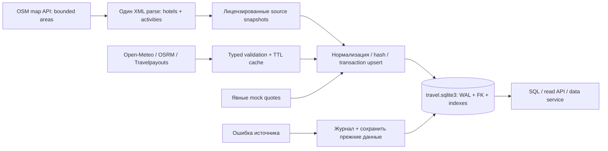
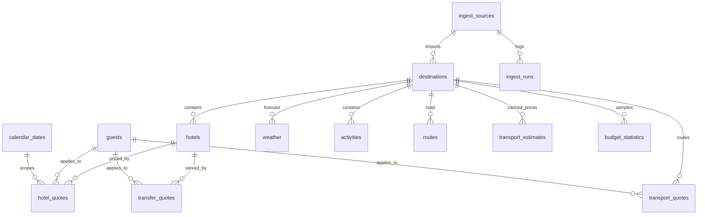

# Общая база проекта — SQLite, схема 2

Рабочий файл: `.runtime/travel.sqlite3`. В нём находятся каталог, цены/оценки, погода, маршруты, журнал загрузки, TTL cache, snapshots, планы, демозаказы и услуги. Каталог доступен через SQL и FastAPI. API больше не перечитывает JSON при поиске отелей/бандлов, compose, explore и mock-tools.

## Что загружено и откуда

| Данные | Источник | Фактический объём при проверке | Статус |
|---|---|---:|---|
| Реальные объекты размещения | OpenStreetMap API, 4 небольших участка городов | 62 | metadata snapshot; не котировки |
| Активности/POI | тот же OSM XML, без второго скачивания | 173 | metadata snapshot |
| Прогноз | Open-Meteo | 12 дневных записей | реальный forecast, 4 города × 3 дня |
| Дорожные маршруты | OSRM | 4 | реальное время/расстояние, цена отсутствует |
| Авиаоценки | Travelpayouts Data API | 3 | cached ticket estimates, bookable=false |
| Отели для демо | fixtures/components | 4 | mock, отдельно от 62 реальных объектов |
| Размещение/дорога/трансферы | scoped demo quotes | 6 / 12 / 12 | mock, точные даты/гости |
| Составы гостей | параметры котировок | 2 | взрослые, возрасты детей, питомцы |
| Направления | справочник проекта | 4 | Сочи, Казань, Дубай, Хургада |
| Визовые профили | неподключённый источник | 3 unknown | нет ложного visa-free/confirmed |

Числа зависят от обновления источников, точное состояние показывает `GET /api/v1/catalog`. Нулевой результат Travelpayouts для маршрута — нормальный empty, а не повод создать цену. Погода имеет даты/valid_until; цены авиаданных не подтверждают наличие и стоимость для всей группы гостей. У реальных OSM-отелей room price, availability, отзывы, питание и pets остаются NULL/unknown, пока отдельный источник не подтвердит их.

## Архитектура загрузки



Не скрейпим страницы Booking/Островка и не ждём их API для построения каталога. OSM скачивается ограниченными областями, с идентифицирующим User-Agent, паузами и кэшем. Полные XML не коммитятся; в репозитории только выбранные объекты. Полноты всех отелей города нет: bbox/coverage и даты сохранены. Название/звёзды в OSM могут устареть; неизвестные поля не достраиваются из догадок.

Для гостиничных тарифов альтернативный проверенный по документации кандидат — [LiteAPI/Nuitee](https://docs.liteapi.travel/reference/post_hotels-rates), а не обязательный API Островка. Он требует отдельного ключа; sandbox не доказывает реальные тарифы/наличие. В этой поставке LiteAPI-клиент не подключён, реальные гостиничные котировки ещё отсутствуют. Их схема и связка с hotel/guests/dates уже есть.

## Таблицы и соответствие доске



- `destinations`: city/country, координаты, timezone, vibe/seasonality в payload. Гипотезы сезонности по-прежнему unverified.
- `hotels`: реальные объекты **и** отдельно помеченные mock-property; звёзды/рейтинг/отзывы, сайт/адрес, источник, active. Поля closest_airport, distance_to_airport_m, check-in/out time, pets/breakfast/all-inclusive предусмотрены, но не выдуманы для OSM.
- `hotel_quotes`: отдельный тариф на даты и guest profile, amount_minor/currency/basis, питание, вместимость, известность доплат, срок действия. Ночей и price-per-night нет в глобальной карточке отеля: ночи определяются check-in/check-out котировки. Тариф за весь срок не превращается автоматически в цену другой даты.
- `transport_quotes`: scoped flight/train предложения, origin/destination, departure/arrival с offset, duration, stops/carrier (если известны), сумма и источник. Сегменты/пересадки сохраняются в typed payload.
- `transfer_quotes`: оба направления, capacity/child seats, duration, цена за машину, source/scope. Рабочие окна и условия — в typed payload.
- `transport_estimates`: **отдельно** cached ticket prices без применимости ко всему составу гостей; bookable всегда 0.
- `weather`: min/max и срок действия forecast. Колонки avg_c/sea_temp_c/snow_depth_cm остаются NULL, если источник этих данных не предоставил. Среднее min/max не выдаётся за измеренную среднесуточную температуру.
- `guests`: adults, children_ages_json, pets; children_count/total_guests вычисляет SQLite.
- `calendar_dates`: дата, месяц/год, ISO weekday, Sat/Sun weekend и календарный северный season. Это календарь, не климат/локальные праздничные выходные.
- `budget_statistics`: min/p25/median/p75/max/avg стоимости **всего проживания** для месяца, nights, currency, guest profile и source_mode. Пока рассчитано по mock-hotel quotes; это не рыночный индекс реальных отелей. Поля component/direction предусмотрены для дальнейшей статистики транспорта; реальные ticket estimates не смешиваются с all-guests quote.
- `visa_rules`: гражданство/страна назначения/тип паспорта/цель, статус, days_allowed, источник/актуальность/notes. Сейчас unknown, NULL source/checked_at — не проверенное право въезда.
- `activities`: геоточки и категории; `activity_counts` — агрегированный view с числом записей по городу/типу.
- `bundles`: совместимые demo bundles для существующего API; `context_fixtures` — offline mock контекст.
- `ingest_sources`, `ingest_runs`, `catalog_metadata`: hashes, счётчики, статусы, source metadata, время успешной загрузки. Ошибки логируются кодом/типом, без token/ответов с credentials.
- `plans/orders/services`, `provider_cache/observations/snapshots`: существующие runtime-таблицы теперь по умолчанию в том же файле. История заказа хранит immutable JSON snapshot, а не ссылку на изменяемую текущую цену.

`hotel_catalog` — удобный view объектов. Current price/availability намеренно NULL: без дат/гостей/проверенной котировки их нельзя утверждать. Для SQL-поиска тарифа используйте hotel_quotes с точным scope.

## Один запуск загрузчика

```bash
export UV_CACHE_DIR="$PWD/.runtime/uv-cache"
uv sync --frozen
# Без сети: создать/обновить весь каталог из сохранённых sources.
uv run python scripts/load_database.py
# Подгрузить свежую погоду, маршруты и авиаоценки.
uv run python scripts/load_database.py --online
# Полностью обновить OSM snapshots и затем API-данные (реже, не на каждый запрос).
uv run python scripts/load_database.py --refresh-hotels --online
```

--online использует настроенный `TRIP_TRAVELPAYOUTS_TOKEN`, не аргумент командной строки. Не печатайте значение и не кладите ключ в Git. При отсутствующем доступе/ошибке загрузчик завершится ненулевым кодом, сохранив успешные источники и прежние записи неуспешного. Empty и skipped не являются ошибкой.

Обычный startup выполняет только локальную синхронизацию файлов по fingerprint, не сетевой scrape. Подходящий график: API refresh раз в 30–60 минут, OSM реже/вручную; TTL уменьшает повторные запросы. Автоматический cron/фоновые платные запросы не устанавливались. При большом объёме индексированный query дешевле повторного парсинга страниц.

## Доступ через HTTP

```bash
uv run uvicorn trip_data.main:app --host 127.0.0.1 --port 8000
curl --fail http://127.0.0.1:8000/api/v1/catalog
curl --fail 'http://127.0.0.1:8000/api/v1/catalog/hotels?source_mode=snapshot&limit=10'
curl --fail --get --data-urlencode 'city=Сочи' http://127.0.0.1:8000/api/v1/catalog/weather
curl --fail http://127.0.0.1:8000/api/v1/hotels/search \
  -H 'Content-Type: application/json' -d '{"city":"Сочи","min_stars":3,"limit":10}'
```

Допустимые таблицы — только публичный каталог. `plans`, `orders`, runtime cache и произвольный SQL через generic endpoint недоступны. Фильтры/пагинация bound parameters; table name — allowlist. `source_mode=snapshot` отбирает реальные загруженные карточки, `mock` — демонстрационные. Limit максимум 100. Физический SQLite доступен в файловой системе; для UI/агента удобнее API. Авторизации для публичного production deployment здесь нет: это локальный dev backend.

SQL-пример из Python:

```python
import sqlite3
with sqlite3.connect('.runtime/travel.sqlite3') as db:
    hotels = db.execute('SELECT name,stars,website FROM hotel_catalog WHERE city=? AND source_mode=?',
                       ('Сочи','snapshot')).fetchall()
```

## Повторяемость / сохранность

- Файл источника проверяется Pydantic, SHA-256 и import revision; неизменившиеся источники — skipped.
- Смена данных — upsert в транзакции с FK. При ошибке транзакция откатывается; fingerprint успеха не обновляется.
- Удалённые из OSM snapshot объекты деактивируются, а не уничтожают историю заказов.
- IDs принадлежат источникам; один источник не может перезаписать объект другого.
- Деньги — integer minor units (копейки для RUB), никаких сумм через float.
- SQLite WAL + busy timeout позволяют читать во время загрузки. Гарантируется атомарность **по источнику**, а не одна большая транзакция всех независимых API.
- Миграции 1→2 добавляют новые поля, без DROP/reset. Старые `.runtime/state.sqlite3` и `provider-cache.sqlite3` копируются в пустые соответствующие таблицы новой БД при старте default app. Старые файлы сохраняются. Для явных overrides state/cache выбираются отдельные пути, существующие настройки не переопределяются молча.

## Экспорт базы и проверка

```bash
uv run python scripts/export_database.py --output .runtime/catalog-export.sqlite3
uv run pytest -q
uv run python scripts/run_data_evals.py
uv run python scripts/smoke.py
# После перезапуска сервера:
uv run python scripts/smoke.py --restore
```

Экспорт содержит каталог и source metadata, но не планы/заказы/секреты/runtime cache. Существующий export не перезаписывается. Raw XML/исследовательские HTML в `.runtime` не нужны для работы и не коммитятся. Сохранённые OSM snapshots распространяются с ODbL attribution: [лицензия данных](../data/hotels/LICENSE.md).
