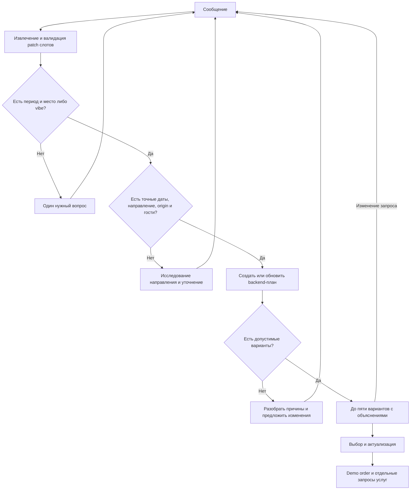

# Роль №1 — Lead AI Engineer: инструкция к работе

Ваш результат — агент, который ведёт диалог, уточняет запрос, показывает до пяти подходящих поездок и пересобирает план после изменений, сохраняя контекст. Вы отвечаете за решения агента и переходы между состояниями. Backend с данными уже есть; чат и граф ещё нужно реализовать.

## 1. Кто за что отвечает

| Область | Владелец | Что использовать / передать |
|---|---|---|
| Слоты, Blocker, вопросы, конфликты, граф, память диалога | **Вы, роль 1** | Новый пакет `trip_agent` и API чата |
| Каталог, API поставщиков, цены, стыковки, сборка поездки, хранение планов | Роль 2 | Готовый `trip_data`; обращаться через контракты ниже |
| Чат, дашборд, отображение слотов и карточек | Роль 3 | Передать схему ответа чата, состояния загрузки/ошибок и версии |
| Промпты извлечения/объяснений, датасет, LLM-evals | Роль 4 | Согласовать JSON парсера и интерфейс запуска агента |
| Vibe, сценарий защиты, формулировки продукта | Роль 5 | Использовать базу знаний; передать воспроизводимый демосценарий |

LLM предлагает значения слотов и текст. Код проверяет типы, применяет изменения, выбирает переходы и вызывает tools. Цены, доступность и подтверждение услуг нельзя получать из свободного ответа модели.

## 2. Сначала запустить готовый backend

Нужны Git, Python **3.12**, uv **0.12.23**. Для первого прохода ключи и LLM не нужны. Если работаете из ZIP, для коммитов перейдите на clone: [общий старт](team-start.md). Команды ниже для Linux/macOS/WSL; [Windows и все зависимости](dependencies.md).

Из корня репозитория:

```bash
export UV_CACHE_DIR="$PWD/.runtime/uv-cache"
uv sync --frozen
uv run python scripts/load_database.py
uv run uvicorn trip_data.main:app --host 127.0.0.1 --port 8000
```

В другом терминале:

```bash
curl --fail http://127.0.0.1:8000/api/health
curl --fail http://127.0.0.1:8000/api/v1/bundles/search \
  -H 'Content-Type: application/json' -d @data/fixtures/search-request.json
```

Ожидается одна mock-опция с суммой `73000.00 RUB` и предупреждением `DEMO_DATA`. Это тестовый тариф. Интерактивный контракт: `http://127.0.0.1:8000/docs`; сохранённый: [openapi.json](openapi.json).

## 3. Где какой код

| Файл / каталог | Назначение |
|---|---|
| `backend/src/trip_data/models.py` | `Slot`, `SlotStatus`, `Guests`, `TripRequest`, `SearchOutput`, `Issue` |
| `backend/src/trip_data/plan_models.py` | План, patch, выбор, demo order, запрос услуги |
| `backend/src/trip_data/main.py`, `routes.py` | Существующие HTTP endpoints и подключение приложения |
| `backend/src/trip_data/state.py` | Сохранение плана, проверка версии, применение частичного patch |
| `backend/src/trip_data/validation.py` | Проверки цены, ограничений и временных стыковок; коды причин отказа |
| `backend/src/trip_data/context_models.py`, `knowledge.py` | Схемы контекстных tools и исследования направления |
| `data/fixtures/search-request.json` | Рабочий точный запрос: вложены `request` и `plan_version` |
| `data/fixtures/component-source.json` | Примеры запросов для четырёх направлений и пересборки |
| `scripts/smoke.py`, `backend/tests/test_workflows.py` | Примеры полного backend-сценария, версий и идемпотентности |
| `backend/src/trip_agent/` | **Создать вам:** парсер, граф, состояние диалога, tools-клиент, chat API |

Предлагаемая структура нового пакета: `state.py` — состояние диалога; `parser.py` — извлечение; `graph.py` — переходы/Blocker; `conflicts.py` — варианты разрешения; `tools.py` — клиент data API; `routes.py` — API чата. Это план файлов, готового агента в них пока нет.

Используйте существующие общие модели. Если создаёте отдельный пакет `trip_agent`, добавьте его к `trip_data` в `tool.hatch.build.targets.wheel.packages` в `pyproject.toml`, затем выполните `uv sync` и проверьте импорт. Тесты разместите в `backend/tests/test_agent_*.py`: этот каталог уже охвачен pytest/CI.

Начните с обычного автомата на Python. LangGraph необязателен. Если выбираете его, добавьте зависимость через `uv add --group agent 'langgraph>=1,<2'` и коммитьте **оба** файла `pyproject.toml` и `uv.lock`; после этого команда установки — `uv sync --frozen --group agent`. Пока группы нет, устанавливать её нельзя. LLM SDK выбирайте вместе с ролью 4; ключ храните в секретах среды.

## 4. Как должен работать агент



**Слоты:** `YES` — значение известно; `Vague` — приблизительно/неоднозначно; `NO` — не предоставлено. Фраза «без животных» даёт подтверждённое `pets=0`, а не статус `NO`. Сохраняйте `evidence` из сообщения пользователя. Существующий `Slot.value` имеет ограниченный набор типов; для дополнительных структур вводите явную схему, согласуя изменения общего контракта.

**Blocker по доске:** нужен период (даты, месяц или сезон) и место **либо** vibe. При отсутствии периода спросить его; затем при необходимости место/тип отдыха. Не спрашивайте уже известное. «Недорого» не превращается в придуманную сумму; «на море» не означает автоматически Сочи.

**Исследование и котировка:** для исследования достаточно месяца и vibe. Для точной поездки нужны направление, origin, даты, число взрослых, возраст каждого ребёнка и выясненные требования к животным. Бюджет необязателен по API; если задан — это общая сумма RUB за поездку для всех гостей. API содержит defaults, но агент не должен выдавать их за явно подтверждённые пользователем ответы.

**Конфликты:** различайте неоднозначность запроса, несовместимые требования и сбой поставщика. Используйте `rejected[*].code`, `issues`, `limitations`, `provider_reports`. Например, `OVER_BUDGET` — предложить изменить бюджет/даты/категорию; `PETS_UNCONFIRMED` — объяснить отсутствие подтверждения, а не объявлять запрет; `CONNECTION_TOO_SHORT` — искать другую дорогу. Предложите 3–5 обоснованных изменений, если они есть; не выдумывайте варианты ради числа. Жёсткие требования меняйте только после согласия пользователя.

**Объяснения:** почему подходит, компромиссы и риски — только по фактам ответа. `warning` не равен отказу. При пустом поиске не возвращайте вчерашнюю цену как новую.

## 5. Какие API вызывать

Снимки расписания ЖД: `GET /api/v1/rail/schedule?origin=Москва&destination=Казань`; они без дат и не подтверждают стыковку или наличие. [Источники и ограничения](sources-and-access.md).

Основной источник фактов — общая БД. Ориентиры по отелям без ключа: [Xotelo](xotelo.md), `GET /api/v1/hotels/estimates?city=...`; ставки не подтверждают стоимость тура. Для контекста используйте `POST /api/v1/catalog/context`: он читает только БД, исключает mock и просроченный контекст, показывает пробелы. [Архитектура наполнения и формат запроса](database-first.md). Прямые сетевые `/tools/*` не требуются в основном графе при выборе этого режима.

Все пути ниже **уже реализованы**. Точные тела и ответы смотрите в OpenAPI.

| Действие | Endpoint | Особенность |
|---|---|---|
| Исследовать направление | `POST /api/v1/explore` | `{"month":11,"vibe":"beach"}`; сезонность — непроверенная гипотеза команды |
| Найти поездки без сохранения | `POST /api/v1/bundles/search` | `SearchInput`: `request` + `plan_version`; максимум пять допустимых |
| Собрать из компонентов | `POST /api/v1/bundles/compose` | То же тело; отдельная сборка компонентного каталога |
| Создать сохраняемый план | `POST /api/v1/plans` | **Сам `TripRequest`, без обёртки**; вернёт `id`, `version`, `request`, `search`, `selected_id` |
| Восстановить план | `GET /api/v1/plans/{id}` | Backend хранит план, но не сообщения/слоты диалога |
| Пересобрать план | `PATCH /api/v1/plans/{id}` | `base_version` + частичные `changes`; выполняет новый поиск |
| Выбрать вариант | `POST /api/v1/plans/{id}/selection` | `base_version`, `bundle_id`; **увеличивает версию** |
| Создать demo order | `POST /api/v1/plans/{id}/checkout` | `base_version`, `idempotency_key` (8–100 символов); только демо |
| Запросить услугу | `POST /api/v1/orders/{id}/services` | `kind`: `early_check_in` / `transfer`; `idempotency_key`; стартует как `pending` |
| Контекст | `POST /api/v1/tools/weather`, `/route`, `/places`, `/flights`, `/rail`, `/entry-rules` | Разные схемы запросов; проверять `status`, режим и предупреждения |
| Реальные карточки размещения | `POST /api/v1/hotels/search` | OSM-метаданные; не подтверждают стоимость/наличие |
| Состояние данных | `GET /api/v1/providers`, `/api/v1/catalog-quality` | Доступность источников и ограничения покрытия |

Для основного диалога используйте `/plans`: он уже сохраняет состояние поездки и защищает от конкурирующих изменений. `/bundles/requote` — старый **stateless** endpoint; он не заменяет хранение плана и контроль версии.

Пример изменения существующего плана:

```json
{
  "base_version": 1,
  "changes": {
    "check_in": "2026-11-12",
    "check_out": "2026-11-17",
    "guests": {"children_ages": [7]}
  }
}
```

Неуказанные поля сохраняются, включая `guests.adults` и `guests.pets`. Массив `children_ages` заменяется целиком. `budget:null` очищает бюджет; обязательные поля нельзя очищать. Неверный patch — 422. Устаревшая версия — 409 с `detail.code=STALE_PLAN_VERSION`: загрузите актуальный план и повторно сопоставьте изменение, не перезаписывая его старым ответом.

Backend может сохранить выбранный вариант/тот же объект размещения, если он есть в новых допустимых результатах. Иначе выбор сбрасывается. После каждого изменения/выбора сохраняйте **вернувшуюся** версию. Уже оформленный demo order остаётся отдельным снимком; patch плана не меняет заказ.

## 6. Что ещё нужно написать вам

1. **Состояние диалога:** `session_id`, сообщения, слоты с evidence, фаза, pending question, конфликты, `plan_id`, версия, выбор. Неполные слоты хранятся здесь; `TripRequest` создаётся только после проверки готовности.
2. **Парсер:** валидируемый частичный patch, обработка невалидного JSON и timeout. Сначала stub для интеграции, затем LLM и промпты роли 4; явно различать эти режимы.
3. **Граф:** правила выше, отсутствие повторных вопросов, обработка пустых результатов и ошибок tools.
4. **Память:** сохранить сообщения, слоты и фазу после каждого шага; восстановить после рестарта. Backend `plans` этого не делает. Используйте отдельную agent-БД или согласованные новые таблицы, не меняя вручную служебные таблицы data-сервиса.
5. **API для UI:** предложить создание сессии, отправку сообщения, чтение состояния и выбор варианта. Эти chat endpoints **ещё не существуют**; реализовать и зарегистрировать, затем экспортировать OpenAPI. С ролью 3 выбрать polling или SSE.
6. **Защита от гонок:** отдельно версия/идентификатор обработки сообщения и версия backend-плана. Старый LLM/tool-ответ не должен заменять новое состояние. Timeout сохраняет контекст и позволяет повторить действие.
7. **Наблюдаемость:** trace ID, шаг графа, время LLM/tools, число уточнений и коды ошибок. Не логировать ключи и лишние персональные данные.

В контракте UI явно предусмотреть `clarification`, `research`, `searching`, `options`, `conflict`, `no_results`, `error`; это предлагаемые состояния, не готовый HTTP-контракт. Возвращать обновлённые слоты, вопрос, варианты, предупреждения, `plan_id`/версию и режим данных. Структуру и примеры согласовать с ролью 3 в первом PR.

## 7. Очерёдность и критерии готовности

| PR | Что сделать | Проверка результата |
|---|---|---|
| 1 | State, patch, stub-парсер, минимальный chat API, вызов `/plans` | Один диалог до mock-карточки; UI получает документированное состояние |
| 2 | YES/Vague/NO, Blocker, исследование, конфликты | «Недорого в ноябре на море» не создаёт выдуманных дат/цен; известные слоты не переспрашиваются |
| 3 | Пересборка, хранение сессии, защита от гонок | «На два дня позже» сохраняет гостей/питомца/бюджет; рестарт и старый ответ не стирают контекст |
| 4 | LLM-парсер и объяснения, timeout/fallback, eval-интерфейс | Невалидный JSON не ломает сессию; роль 4 запускает сценарии и получает trace/метрики |
| 5 | Выбор, demo order, запрос услуг; общий прогон | Повторное оформление идемпотентно; ранний заезд не объявляется подтверждённым при `pending` |

Сначала рабочий детерминированный проход, затем модель. Не ждите живых отельных цен, чтобы начать граф.

Проверки перед передачей:

```bash
uv run ruff check .
uv run pytest -q
uv run python scripts/export_openapi.py
uv run python scripts/run_data_evals.py
```

Data-evals проверяют backend, **не качество LLM**. Добавьте с ролью 4 отдельные проверки графа: уточнения, конфликт, дети/животные, неоднозначный бюджет, перенос дат, отсутствие результатов, timeout/невалидный JSON, параллельные сообщения и восстановление сессии. После запуска backend используйте `uv run python scripts/smoke.py` как дополнительный пример сквозного data-прохода.

## 8. Ограничения, которые нужно учитывать

- Полные поездки, цены и оформление пока **mock**. OSM-карточки и live-погода не делают бандл реальным.
- Travelpayouts даёт кэшированные авиаоценки, не гарантированное наличие/цену для всей группы. OSRM даёт время/расстояние, не тариф трансфера.
- Реальные отельные тарифы требуют отдельного источника; LiteAPI-клиент подготовлен, доступ зависит от ключа. Визовые правила и живые ЖД/трансферы не подтверждены. [Текущий статус роли 2](role-2-final-status.md).
- `confirmed` через `/simulate` означает только демосимуляцию. Для настоящей услуги нужно подтверждение поставщика.

## 9. Как отдать работу команде

Работайте в своей ветке и открывайте небольшие PR: [правила Git](../CONTRIBUTING.md). В PR укажите: что работает, как запустить, какие endpoints/модели изменены, проверки и что осталось stub/mock. Новые зависимости коммитьте с lockfile; изменения API — с OpenAPI и примерами.

Роли 3 передайте контракт чата и обработку версий; роли 4 — точку запуска агента и trace; роли 2 — необходимые изменения data-контракта; роли 5 — воспроизводимый сценарий защиты и ограничения. Общие модели меняйте совместно с теми, кто их использует.
