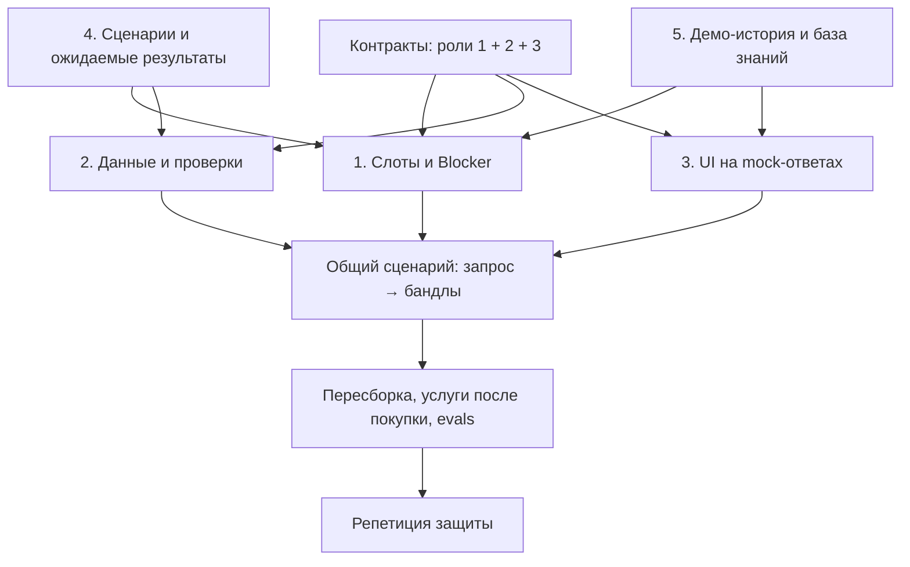

# Старт команды

Этот репозиторий — общая рабочая база пяти ролей. Сейчас работает data API с mock-поездкой; планы AI, UI, evals и защиты находятся рядом с кодом. Наличие плана не означает, что соответствующий модуль уже написан.

## 1. Получить проект

**Для разработки и коммитов — клонировать:**

```bash
git clone https://github.com/nlgpshelnax/xyinya.git
cd xyinya
git switch -c feat/your-name-task
```

Владелец репозитория добавляет участников в GitHub → Settings → Collaborators. Для публичного репозитория без write-доступа можно сделать fork и открыть PR из fork. Для приватного репозитория сначала нужен доступ. Аутентификацию GitHub настройте штатным Git Credential Manager/SSH/CLI; токены не вставляйте в команды или файлы проекта.

**Для знакомства — скачать архив:** [ZIP ветки main](https://github.com/nlgpshelnax/xyinya/archive/refs/heads/main.zip). Распакуйте и откройте каталог `xyinya-main`. Архив содержит исходники, документацию, примеры и lockfile; установленные зависимости скачиваются отдельно. ZIP не содержит `.git`, поэтому из него нельзя выполнить обычный push в общий репозиторий.

Если уже начали правки в ZIP: сохраните эту папку, отдельно выполните `git clone`, создайте ветку и перенесите только изменённые исходники/документы в clone. Проверьте `git diff`. Не переносите `.venv`, `.env`, `.runtime`, `node_modules` или чужую `.git`. Не делайте `git init` поверх архива, чтобы создать несвязанную историю.

В Codex cloud используйте существующий checkout `/workspace/xyinya`: новая задача уже изолирована; дополнительный Git worktree без отдельной просьбы не нужен.

## 2. Выбрать свой план

| Роль | С чего начать | Куда вносить результат |
|---|---|---|
| 1. Lead AI Engineer | [план AI](role-1-ai.md) | `backend/src/trip_agent/`, AI-тесты, согласованные session API |
| 2. Backend / Data | [план Data](role-2-backlog.md) | `backend/src/trip_data/`, `data/fixtures/`, data-тесты |
| 3. Frontend | [план UI](role-3-frontend.md) | будущий `frontend/`, UI-тесты |
| 4. Prompt / QA | [план QA](role-4-qa.md) | будущие `prompts/`, `evals/`, тесты и отчёты |
| 5. Product / Pitch | [план продукта](role-5-product.md) | будущие `pitch/`, `data/knowledge/`, сценарии защиты |

Пути для ещё не созданных модулей — договорённость команды, не готовый код. Создаёт их владелец роли в своём первом PR.

Обязательно всем: [архитектура](architecture.md), [контракты](contracts.md), [зависимости и запуск](dependencies.md), [правила Git](../CONTRIBUTING.md). Сначала сверьте фактический `main`, затем начинайте задачу.

## 3. Проверить исходную точку

Роли 1, 2, 4 устанавливают Python-окружение по [инструкции](dependencies.md). Роли 3 достаточно запущенного backend или примеров API; роль 5 может сразу работать с документацией без установки Python/Node.

Сначала запустите backend, отправьте пример `data/fixtures/search-request.json` и убедитесь, что ответ содержит одну mock-поездку и `73000.00` RUB. Изменение дат без подходящей котировки не должно давать ту же цену. Не ожидайте полноценного чата: agent/session API ещё предстоит написать роли 1.

## 4. Общая очерёдность



Первый общий результат — один сквозной сценарий с честными mock-метками. Новые направления и API подключаются после него. У каждой задачи должны быть исполнитель, вход, результат, проверка и PR.

## 5. Передать работу

В PR напишите: что изменилось, как запустить, что проверено, какой контракт затронут и что осталось mock. Ежедневно объединяйте небольшие готовые части. Роль 1 проверяет интеграцию графа, роль 2 — данных; роль 4 отвечает за общий прогон, роль 5 — за готовность демо. Ни одна роль не должна молча менять общие модели или endpoint, используемый коллегами.

Обновление 0.3.0: [полная data-поставка](data-delivery.md). Дополнительных Python-пакетов нет. Новые переменные описаны в `.env.example`: TRIP_EXTERNAL_MODE (mock по умолчанию), TRIP_TRAVELPAYOUTS_TOKEN (секрет), TRIP_STATE_PATH, TRIP_COMPONENT_CATALOG_PATH, TRIP_CONTEXT_FIXTURE_PATH, TRIP_KNOWLEDGE_PATH. Состояние .runtime сохраняется локально и не коммитится.
